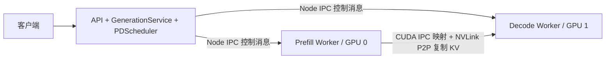

<p align="center">
  <a href="https://landowang.github.io/sprout-lm/">
    
  </a>
</p>

<h1 align="center">SproutLM</h1>

<p align="center"><strong>让推理的每一步，看得见。</strong><br>TypeScript orchestrates. CUDA computes.</p>

<p align="center">
  <a href="https://landowang.github.io/sprout-lm/">项目主页</a> ·
  <a href="MILESTONES.md">开发里程碑</a> ·
  <a href="snapshot/README.md">实验快照</a>
</p>

---

用 TypeScript 拆解 LLM 推理引擎的核心机制：连续批处理、分块 prefill、分页 KV cache、前缀复用、内存压力下的抢占与重算。模型结构保留在 TypeScript，设备计算可以通过原生扩展接入。

支持两个 CPU 执行实现：默认的 **TinyTransformer**（2 层、2 个 head、宽度 16、未训练随机权重）用于观察机制；**QwenRunner** 原生加载 Qwen2 权重，首个验证模型为 **Qwen2.5-0.5B-Instruct**。权重加载、前向计算、调度和分页 KV 都在本项目内运行。

默认是 CPU 教学实现。Attention 确实通过页表读取实际 K/V 数值；每轮 batch 中的请求依次执行。CUDA 支持两类实验：原来的混合 CLI 只将矩阵计算交给 GPU；`BACKEND=cuda` 则使用 TypeScript **CudaQwenRunner** 编排完整 GPU 前向、设备分页 KV 和 GPU greedy 采样，已部署 Qwen2.5-32B-Instruct。单个 Worker 仍逐 token、逐请求执行，没有张量 batch。新增 `BACKEND=cuda-pd` 将 API / Scheduler、Prefill、Decode 拆成三个进程，双卡通过 CUDA IPC / NVLink 交接 KV，P 和 D 可并行推进。

重要实验保存在 [snapshot/](snapshot/README.md)，包括首次 72B CPU + GPU 协同推理的设计、结果和原始日志。

开发阶段、feature 拆分与验收标准见 [MILESTONES.md](MILESTONES.md)。

## 运行

需要 Node.js 24+，直接运行 TypeScript。文本插件依赖 Hugging Face 的 JavaScript tokenizer / Jinja 库，模型计算不依赖外部推理框架：

```sh
git clone https://github.com/LandoWang/sprout-lm.git
cd sprout-lm
npm ci
npm run demo
npm run demo -- --pressure
npm test
```

普通演示中，A/B 先入队，C 在两轮后加入，复用 A 的共享前缀。输出逐轮展示 prefill/decode、计算 token 数和逻辑页到物理页的映射。

`--pressure` 把 KV 池从 18 页缩到 5 页，观察 `preempted`、重新入队与 `recompute`。`node src/demo.ts --json` 输出可供分析的完整 JSON；也可以同时传入 `--pressure`。

类型检查需要开发依赖：

```sh
npm ci
npm run check
```

## 运行真实 Qwen 模型

```sh
npm run model:download
MODEL_DIR=models/qwen2.5-0.5b-instruct npm run serve
```

下载脚本默认固定 `Qwen/Qwen2.5-0.5B-Instruct` 的 revision `7ae557604adf67be50417f59c2c2f167def9a775`，逐文件核对 Hub 提供的内容哈希。原始 BF16 权重约 988 MB，加载后 FP32 权重约 1.98 GB，另需 KV、tokenizer 与临时空间。模型目录和参考数据不进入 Git。重复下载会验证已有文件后跳过。其他模型用 `MODEL_REPO` 和固定的 `MODEL_REVISION` 指定；脚本支持分片清单，默认两个并发下载，每个文件失败最多重试两次。

```sh
curl -N http://127.0.0.1:3000/generate \
  -H 'Content-Type: application/json' \
  -d '{"messages":[{"role":"user","content":"你好，请简单介绍自己。"}],"maxNewTokens":32,"stream":true}'
```

`messages` 使用该 checkpoint 的对话模板；`prompt` 文本直接编码，适合原始续写；`prompt` token 数组不经过模板或编码。`messages` 与 `prompt` 必须二选一。目前仅支持纯文本的 system / user / assistant 消息，不支持工具调用和多模态输入。

服务启动后默认只使用 512 个 KV token 槽位（Qwen 模式），可通过 `KV_TOKENS` 调整，按 16-token 页向上取整。此池供所有请求共享，并受到模型 32768 上下文上限约束。不要因为模型声明长上下文就直接用纯 JS 跑很长的 prompt；本实现逐位置计算，单轮计算期间不能响应新 I/O。

Qwen 路径使用 FP32 存储，乘加和部分归约使用 JavaScript number；greedy 采样不应用 checkpoint 的 temperature、top-p 或 repetition penalty。读取 `generation_config.json` 的 EOS 列表（缺失时使用模型配置），输出原始 EOS token 并将它计入 completion usage，文本 decoder 隐藏特殊 token。结束原因是 `eos` 或 `length`。

支持单个 `model.safetensors` 或 `model.safetensors.index.json` 指向的分片，检查参数 shape 与文件范围，最多同时保留八个读取句柄。默认 CPU 路径将 F32 / BF16 / F16 转成 FP32。已实现 RoPE、GQA、学习型 RMSNorm、QKV bias、SwiGLU、共享或独立输出投影；尚不支持量化、滑窗、RoPE scaling 或自动识别任意模型架构。

### A100 混合实验：CUDA 矩阵计算与权重常驻

`CUDA_WEIGHT_MODE=offload`（默认）用于试运行超过当前空闲显存容量的 Qwen2 模型。权重文件只读映射在主机地址空间，由操作系统页缓存承载；每次矩阵乘法将权重按行分块上传。默认 `CUDA_MATVEC=direct` 直接读取 BF16 / F16，用 FP32 累加，不展开 FP32 权重矩阵；F32 使用 cuBLAS SGEMV。`CUDA_TILE_MIB` 仍按 FP32 等效元素数限制每块，默认 128 对应最多约 64 MiB 的半精度上传缓冲，加上小型向量空间；CUDA context 和 cuBLAS 自身占用另算。

`CUDA_WEIGHT_MODE=resident` 在加载时一次上传所有矩阵权重，保持 checkpoint 的 BF16 / F16 / F32 存储格式。默认直接读取设备上的半精度权重并用 FP32 累加，无需权重上传缓冲或 FP32 权重转换工作区；没有使用 Tensor Core GEMM。混合路径的 embedding 行读取仍从主机映射执行，norm / bias 等小型参数仍在 CPU。主机文件映射保留，RSS 可能包含被读过的文件页。设置 `CUDA_MATVEC=convert` 可恢复原来的分块转换 + SGEMV 路径做对照。

在这两种混合模式中，Runner 的层循环、RoPE、归一化、Attention、激活、采样及分页 KV 仍在 TypeScript / CPU。所有原生调用同步完成，只在调度轮之间让出事件循环。完整 GPU 路径见下一节。权重映射期间文件必须保持不变。offload 模式下，主机内存不足以缓存权重时会反复读盘，长 prompt 也会逐 token 反复搬权重。

在 Linux A100 主机安装 Node.js 24+、Node-API 头文件、CUDA Toolkit 和 cuBLAS 后：

```sh
npm ci
npm run build:cuda
npm run test:cuda
PROMPT='1+1=' MAX_NEW_TOKENS=2 REPORT_PATH=runs/smoke.json \
  npm run smoke:cuda -- models/qwen2.5-0.5b-instruct
```

`CUDA_PATH` 默认 `/usr/local/cuda`，`NODE_INCLUDE` 默认 `/usr/include/node`；构建目标为 A100 的 `sm_80`。`CUDA_DEVICE` 默认 0，`CUDA_TILE_MIB` 默认 128。`CHAT=1` 会应用模型对话模板；默认直接续写 `PROMPT`。CLI 限制 prompt 与输出总计不超过 256 token，并在结束时释放原生资源。`npm run serve` 仍使用默认 CPU 路径。

常驻模式可用 `CUDA_WEIGHT_LIMIT_MIB` 限制矩阵权重总量（默认 0，不额外设置总量上限），用 `CUDA_RESERVE_MIB` 指定每次分配后至少保留的设备空闲空间（默认 1024 MiB，需容纳后续工作区）。超预算或设备余量不足时明确失败，CLI 会关闭已创建的资源，不自动退回 offload。报告将 `loadStats` 与 `generationTransfers` 分开，`matvecWeightUploadBytes=0` 表示生成期间没有重复上传权重；输入 / 输出向量仍在 CPU 与 GPU 间传输。

单卡 14B 实验：

```sh
MODEL_REPO=Qwen/Qwen2.5-14B-Instruct \
MODEL_REVISION=cf98f3b3bbb457ad9e2bb7baf9a0125b6b88caa8 \
  npm run model:download -- models/qwen2.5-14b-instruct
CUDA_DEVICE=0 CUDA_WEIGHT_MODE=resident CUDA_WEIGHT_LIMIT_MIB=32768 CUDA_RESERVE_MIB=4096 \
CHAT=1 PROMPT='用一句话解释为什么天空是蓝色的，不超过40个汉字。' MAX_NEW_TOKENS=64 \
REPORT_PATH=runs/cuda-resident-14b-chat.json \
  npm run smoke:cuda -- models/qwen2.5-14b-instruct
```

14B 权重载荷约 29.54 GB / 27.51 GiB，选择时 GPU 0 空闲约 46.2 GiB，保留了运行余量。`npm run test:cuda` 覆盖两种权重模式；已有独立 0.5B 参考数据时，用 `MATRIX_BACKEND=cuda-offload CUDA_WEIGHT_MODE=resident npm run test:model` 对照常驻路径的完整 logits。

本次 72B 目标固定为：

```sh
MODEL_REPO=Qwen/Qwen2.5-72B-Instruct \
MODEL_REVISION=495f39366efef23836d0cfae4fbe635880d2be31 \
  npm run model:download -- models/qwen2.5-72b-instruct
CUDA_DEVICE=0 PROMPT='1+1=' MAX_NEW_TOKENS=2 REPORT_PATH=runs/cuda-72b-smoke.json \
  npm run smoke:cuda -- models/qwen2.5-72b-instruct
```

该 checkpoint 有 37 个分片，原始权重约 145.4 GB / 135.4 GiB；下载前确认磁盘与主机内存预算。短样本的结果及局限记录在 [MODEL_VALIDATION.md](MODEL_VALIDATION.md)。准备好已有 0.5B 独立参考数据后，可用 `MATRIX_BACKEND=cuda-offload npm run test:model` 对照完整 logits、分页调度及 HTTP 行为。

### A100 单卡部署：完整 GPU 前向与设备 KV

`BACKEND=cuda` 选择 `CudaQwenRunner`：TypeScript 保留层循环和算子顺序，Node-API 提供通用设备算子。Embedding、RMSNorm、QKV / 输出 / FFN 投影、RoPE、分页 GQA、SwiGLU、残差和 argmax 全部在 GPU。Tokenizer、模板、请求调度和页引用管理仍在 CPU。

矩阵权重保留 checkpoint dtype；默认 CUDA 算子直接读取 BF16 / F16，在寄存器内转成 FP32 并累加，不生成 FP32 权重临时矩阵。F32 矩阵继续使用 cuBLAS SGEMV，`CUDA_MATVEC=convert` 保留旧转换路径。激活、norm / bias 和 KV 使用 FP32；归一化、位置编码和 attention 的部分中间运算使用 FP64，以贴近现有教学参考。当前没有使用 Tensor Core GEMM 或 FlashAttention。GPU 前向结束后才发布 KV、提交 token 或释放页；服务在调度轮之间响应 I/O 和取消，单轮仍同步等待 GPU。

固定单卡模型为 `Qwen/Qwen2.5-32B-Instruct@5ede1c97bbab6ce5cda5812749b4c0bdf79b18dd`。原始权重约 65.53 GB / 61.03 GiB，17 个分片。配置 2048 个 FP32 KV token 需要 1 GiB KV，另有激活和 CUDA / cuBLAS 开销；默认 direct 模式无需 FP32 权重转换工作区，convert 对照模式仍使用最多约 128 MiB；单卡 A100 80GB 有运行余量。

```sh
MODEL_REPO=Qwen/Qwen2.5-32B-Instruct \
MODEL_REVISION=5ede1c97bbab6ce5cda5812749b4c0bdf79b18dd \
  npm run model:download -- models/qwen2.5-32b-instruct
npm run build:cuda
npm run test:cuda-device
BACKEND=cuda MODEL_DIR=models/qwen2.5-32b-instruct KV_TOKENS=2048 \
CUDA_DEVICE=0 CUDA_WEIGHT_LIMIT_MIB=69632 CUDA_RESERVE_MIB=4096 \
HOST=127.0.0.1 PORT=3000 npm run serve
```

`KV_TOKENS` 是所有活跃请求和缓存前缀共用的池容量；默认最多 4 个活跃请求，按 token 预算依次执行，并非四个请求各有 2048 个槽。服务使用 SproutLM 原生 `/generate` JSON / SSE 协议。当前部署绑定 A100 的回环地址，可通过 SSH 转发访问：

```sh
ssh -N -L 3000:127.0.0.1:3000 yuawang-a100x2
# 在另一个终端：
curl http://127.0.0.1:3000/generate -H 'Content-Type: application/json' \
  -d '{"messages":[{"role":"user","content":"你好，用一句话介绍你自己。"}],"maxNewTokens":64,"stream":true}'
```

历史单卡服务配置保存在 [deploy/sprout-lm-32b.service](deploy/sprout-lm-32b.service)。当前 A100 已切换到下方的 `sprout-lm-pd` 三进程服务；旧 `sprout-lm-32b` 已停止并取消开机启动，原代码和配置保留供回退。以下是旧服务的管理命令，在 A100 上执行：

```sh
sudo systemctl status sprout-lm-32b
sudo systemctl stop sprout-lm-32b
sudo systemctl start sprout-lm-32b
sudo journalctl -u sprout-lm-32b -n 30 --no-pager
```

独立 CLI 使用 `CUDA_EXECUTION=full npm run smoke:cuda -- MODEL_DIR`；真实 0.5B 参考验证使用 `MATRIX_BACKEND=cuda-device npm run test:model`。32B 的离线参考脚本为 `scripts/reference-smoke.py`，CPU FP32 / eager，需要约 122 GiB 的 FP32 权重空间；生成参考后用 `node scripts/check-cuda-model.ts MODEL_DIR REFERENCE_DIR` 比较。Python 仅用于离线验证，不参与服务。

完整结果和原始证据见 [32B GPU 实验快照](snapshot/2026-10-19-qwen32b-gpu/README.md)。

### 可选 CUDA Graph：单 token 输出前向

`CUDA_GRAPH=1` 在完整 GPU 路径启用 Graph；默认 `0`，保留逐算子提交。首次输出先执行一次普通前向以预热 cuBLAS，再由 TypeScript Runner 捕获 Embedding、64 层计算、LM head 和可选的 GPU argmax。后续输出前向一次重放；不需要输出的 prefill token 仍逐算子执行。

Graph 使用稳定的设备工作区和 pinned host 输入缓冲，每次更新 token ID、position 和当前请求的 block table。调度器仍负责页号、前缀共享和引用。每个 Runner 最多保留当前 KV 池的 logits / sample 两张图，切换池会释放旧图，关闭 backend 会先销毁图再释放 tensor。捕获失败会明确报错并清理，不静默退回普通执行。

```sh
CUDA_DEVICE=1 CUDA_GRAPH=1 npm run test:cuda-device
CUDA_DEVICE=1 CUDA_GRAPH=1 MATRIX_BACKEND=cuda-device npm run test:model
CUDA_DEVICE=1 CUDA_MATVEC=convert CUDA_GRAPH=0 REPORT_PATH=runs/eager.json \
  npm run bench:cuda-graph -- models/qwen2.5-32b-instruct
CUDA_DEVICE=1 CUDA_MATVEC=convert CUDA_GRAPH=1 REPORT_PATH=runs/graph.json \
  npm run bench:cuda-graph -- models/qwen2.5-32b-instruct
```

同一张卡按顺序执行对照，确保有足够空闲显存。脚本关闭前缀缓存，记录一个包含初始化 / 捕获成本的冷请求，再记录默认三个稳定请求，比较相同输出序列的首 token 和 decode 分布。`REPETITIONS`、`MAX_NEW_TOKENS`、`PROMPT` 可调整，逐轮和汇总数据保存在报告中。

HTTP 服务可在 `BACKEND=cuda` 基础上设置 `CUDA_GRAPH=1`。Graph 仍在每个 token 结束时同步等待，不改变 event loop、调度轮或取消语义；没有算子融合、JIT、batch prefill 或多请求张量 batch。CUDA event 区间包含提交空档与读回，不能作为 GPU 利用率。

早期 convert 矩阵路径的 32B 实测稳定 decode 从 264.650 降至 259.467 ms/token，约提升 2%；反向复测约 1.88%。完整正确性、Nsight 时间线和原始记录见 [CUDA Graph 实验快照](snapshot/2026-10-19-cuda-graph/README.md)。

### 直接读取 BF16 / F16 权重

默认 `CUDA_MATVEC=direct`，也可通过 `new CudaDeviceBackend({ matvec: 'direct' })` 显式选择。通用 CUDA GEMV 直接从半精度权重计算，激活与累加保持 FP32；每个 warp 计算一行，按宽度选择对齐向量读取或带边界检查的标量读取。BF16 / F16 在寄存器中转换，不再写出并重新读取整块 FP32 权重。F32 权重仍使用 SGEMV，TypeScript 模型结构、页引用和 Graph 重放协议保留。

`CUDA_MATVEC=convert` 保留原来的转换 + SGEMV 路径，便于验证与对照；选项创建 backend 时固定。两种模式都可使用 `CUDA_GRAPH=0|1`。更新本机源码后需重新 `npm run build:cuda`，原生接口也已更新。

```sh
npm run build:cuda
CUDA_DEVICE=1 npm run test:cuda-matvec
CUDA_DEVICE=1 CUDA_MATVEC=convert CUDA_GRAPH=1 REPORT_PATH=runs/convert.json \
  npm run bench:cuda-graph -- models/qwen2.5-32b-instruct
CUDA_DEVICE=1 CUDA_MATVEC=direct CUDA_GRAPH=1 REPORT_PATH=runs/direct.json \
  npm run bench:cuda-graph -- models/qwen2.5-32b-instruct
```

32B、同一张 A100、两边均开启 Graph：稳定 decode **259.471 → 66.459 ms/token**，**3.854 → 15.047 token/s（3.90 倍）**；47-token prompt 的无前缀复用首 token **11.999 → 3.033 s**。每边 93 次稳定 decode，输出 token 一致，0.5B / 32B 独立 logits 保持原容差。这里只优化了矩阵向量乘，仍无 Tensor Core GEMM 或张量 batch。

结果和原始证据见 [BF16 直接读取实验快照](snapshot/2026-10-19-bf16-matvec/README.md)。该次 GPU 1 实验结束时没有切换常驻服务；之后的三进程 PD 部署已采用此算子。

### 三进程 Prefill / Decode 分离

`BACKEND=cuda-pd` 启动一个 API / GenerationService / Scheduler 协调进程，以及两个独立 Node.js Worker。P 在 GPU 0 做 prefill，D 在 GPU 1 做 decode；两张卡各自加载完整模型。模型层循环仍在 TypeScript，通用计算和 CUDA IPC 留在原生扩展。协调进程不创建 CUDA context，也不分配主机 KV 数值数组。



启动时导出 P 的 KV 大池，D 用 CUDA IPC 映射一次。P 返回完成消息时 GPU 已完成计算；D 根据源 / 目标页号做设备间复制，只传有效 token 的 K/V。D 的 CUDA event 确认完成后才回 ACK，Scheduler 随后释放 P 页并安排 decode。没有通过 Node IPC 传 KV，也没有网卡 RDMA 或主机 staging 回退。

页账本只在 Scheduler。第一版开始 prefill 前预留 P 的 prompt 页和 D 的整个请求容量；容量不足就排队。每个 Worker 同时接收一个执行计划，P 按 chunk 轮转，D 在就绪的交接 / decode 请求间轮转。两者独立推进，P 未完成的 chunk 不会阻止 D 继续运行。P 可以直接返回首 token；若首 token 已达到 EOS / 输出上限，就不传 KV。

取消立即结束用户流，正在计算或复制的页继续保留，完成 ACK 后才回收。每条 Worker RPC 有单调递增编号，并核对完成消息中的请求 ID；不自动重连或复用旧池。任一 Worker 异常时整组停止，先退出 D importer、再退出 P exporter；服务进程以失败状态退出，由 systemd 重启整组。关闭也遵循这个顺序。

```sh
npm run build:cuda
npm run test:cuda-pd
BACKEND=cuda-pd MODEL_DIR=models/qwen2.5-32b-instruct \
PREFILL_DEVICE=0 DECODE_DEVICE=1 CUDA_MATVEC=direct CUDA_GRAPH=1 \
CUDA_RESERVE_MIB=4096 KV_TOKENS=2048 HOST=127.0.0.1 PORT=3000 npm run serve
```

`KV_TOKENS` 是**每张卡**的池容量，`MAX_SEQUENCES` 默认 4，`PREFILL_CHUNK_SIZE` 默认 4。原 `/generate` JSON / SSE、`/health` 和取消接口保留。API 进程可在 Worker 的同步 CUDA 调用期间响应 I/O；Worker 内部仍同步等待每个计算 / 复制计划完成。尚无 PD 前缀缓存、抢占重算、张量 batch、传输与 D 计算重叠、跨机器传输或 Worker 无损恢复。

当前常驻服务为 `sprout-lm-pd`，部署目录 `/mnt/nvme/sprout-lm/deployments/pd`，启用开机启动和失败重启，监听原来的 `127.0.0.1:3000`。每张卡 2048-token FP32 KV 池，各 1 GiB；两卡各占约 62.46 GiB 显存。部署配置见 [deploy/sprout-lm-pd.service](deploy/sprout-lm-pd.service)。

实测 32B 的 93 个稳定 HTTP/SSE token 间隔平均 66.996 ms（约 14.93 token/s），47-token prompt 的首 token 平均 3.024 s。另一个请求 prefill 时，已有请求的 31 次 decode 均有 Worker 执行区间重叠；健康检查 p95 约 0.675 ms。详细测试、复现和限制见 [三进程 PD 实验快照](snapshot/2026-10-19-pd-three-process/README.md)。

### 插件式文本处理

`runtime.ts` 负责装配模型、tokenizer 和模板。它们分别加载，Engine / Runner 仅处理 token ID，不依赖具体文本插件。

| 配置 | Qwen 默认值 | 用途 |
| --- | --- | --- |
| `MODEL_DIR` | 不设置则用 TinyTransformer | 配置与权重目录 |
| `TOKENIZER_PLUGIN` | `hf-bytelevel` | 已注册的 tokenizer 工厂名 |
| `TOKENIZER_DIR` | `MODEL_DIR` | tokenizer 资源目录 |
| `TEMPLATE_PLUGIN` | `jinja` | 独立对话模板工厂名 |
| `TEMPLATE_DIR` | `MODEL_DIR` | 含模板的资源目录 |

可以通过 `TextPluginRegistry.registerTokenizer()` / `registerTemplate()` 注册自己的实现，并将 registry 传给 `createRuntime({ plugins, ... })`。内置 `byte` 教学 tokenizer 和 `hf-bytelevel` BPE tokenizer；后者适配本次 Qwen 资源，不宣称兼容所有 HF tokenizer。它们各自为每个请求创建独立 decoder，保留跨 token 的 UTF-8 字节。

装配检查词表范围与 EOS 特殊 ID，并记录 tokenizer 资源指纹；词表大小一致并不能证明 token 语义相同。正确组合依赖固定资源版本和参考编码样本。分离资源目录时也必须保持这种匹配关系。

## 从哪里读

| 文件 | 关注的问题 |
| --- | --- |
| [src/http.ts](src/http.ts) | HTTP 请求怎样转成生成任务，事件怎样变成 JSON / SSE？ |
| [src/service.ts](src/service.ts) | 多个客户端怎样共用一个调度循环，断连后如何停止生成？ |
| [src/engine.ts](src/engine.ts) | 每轮谁执行、执行多少 token、何时让出内存？ |
| [src/kv-cache.ts](src/kv-cache.ts) | 逻辑位置怎样映射到物理页？谁还持有这页？ |
| [src/model.ts](src/model.ts) | 新 token 怎样使用历史 K/V 算 attention？ |
| [src/runner.ts](src/runner.ts) / [src/qwen.ts](src/qwen.ts) | 模型执行接口与真实 Qwen2 前向计算是什么？ |
| [src/safetensors.ts](src/safetensors.ts) | 如何读取权重并转成 FP32？ |
| [src/weight-files.ts](src/weight-files.ts) | 如何按索引从多个权重分片读取 tensor？ |
| [src/cuda-offload.ts](src/cuda-offload.ts) / [native/cuda-offload.cu](native/cuda-offload.cu) | 如何保留 TS 模型结构，把分块矩阵计算交给 cuBLAS？ |
| [src/qwen-cuda.ts](src/qwen-cuda.ts) / [src/cuda-device.ts](src/cuda-device.ts) / [native/cuda-device.inc](native/cuda-device.inc) | 如何在 TS 编排层循环，让设备算子、分页 KV 和采样全部留在 GPU？ |
| [src/tokenizer.ts](src/tokenizer.ts) | 文本怎样编码，跨 token 的 UTF-8 字符怎样流式解码？ |
| [src/text-plugins.ts](src/text-plugins.ts) / [src/runtime.ts](src/runtime.ts) | 如何独立加载并装配 tokenizer、模板和模型？ |
| [src/demo.ts](src/demo.ts) | 请求动态加入后，每轮调度发生什么？ |
| [test/engine.test.ts](test/engine.test.ts) | 如何证明换了调度和存储布局，计算仍然正确？ |
| [test/service.test.ts](test/service.test.ts) / [test/http.test.ts](test/http.test.ts) | 如何验证流式输出、并发、取消与失败清理？ |

建议按上表顺序读。`Engine.step()` 是一次完整的调度迭代，调用方可以在相邻两次 step 之间加入或取消请求。

## API 适配层

```text
HTTP 客户端
    ↓ JSON / SSE
HTTP 适配层：协议、参数校验、响应、断连
    ↓ token 请求 / 异步生成事件
GenerationService：共享调度循环、输出缓冲、取消、请求清理
    ↓ add / step / cancel / forget
Engine：请求状态、scheduler、KV cache
    ↓ ModelRunner.forwardToken
TinyTransformer / QwenRunner：CPU 计算；CudaQwenRunner：GPU 计算与设备 KV
```

所有连接共用一个 `GenerationService` 和一个 Engine。服务用 `setImmediate()` 每次执行一轮 `step()`，然后把 JS 线程交还 Node.js，让网络 I/O、新请求和取消有机会被处理；有待处理任务才安排下一轮，空闲时停止循环。单轮 CPU 或 CUDA 执行仍然同步完成，不能中途打断；GPU 路径在同一 stream 上执行各算子，token 之间顺序执行。

上图与同步计算说明对应原单进程 Engine。`BACKEND=cuda-pd` 改由同一个 GenerationService 驱动异步 PDScheduler；GPU 计算位于两个子进程，协调进程等待任一 Worker 完成时仍可处理网络 I/O。三进程的职责与交接顺序见上方 PD 章节。

API 层不决定 prefill/decode 顺序或页分配，也不直接调用 `step()`。文本处理经独立 tokenizer 转成 token；以后添加其他协议适配器时，可以复用生成服务。当前提供 **SproutLM 原生协议**、真实模型权重加载、纯文本聊天模板和可选完整 CUDA 前向；Codex 协议适配、工具调用、异步设备执行仍待实现。

`createApiServer({ service, tokenizer, template })` 通过接口注入文本处理插件和可选的聊天模板。直接使用 Engine / GenerationService 时，请传入已经编码的 token ID。

### 启动 HTTP 服务

```sh
npm run serve
```

默认监听 `127.0.0.1:3000`，可通过 `HOST` / `PORT` 修改。这个本地教学服务没有鉴权。三个入口：

| 接口 | 行为 |
| --- | --- |
| `POST /generate` | 提交 prompt，返回完整 JSON 或流式 SSE |
| `DELETE /requests/:id` | 取消活跃请求；已结束或不存在返回 404 |
| `GET /health` | 返回服务状态和待处理请求数；执行故障关闭服务后返回 503 |

完整结果：

```sh
curl http://127.0.0.1:3000/generate \
  -H 'Content-Type: application/json' \
  -d '{"prompt":"hello","maxNewTokens":6}'
```

请求字段：`prompt`（文本或 token ID 数组）与 `messages` 二选一；`maxNewTokens` 默认 16；`stream` 默认 false。不支持的字段会被拒绝。只有教学 byte tokenizer 自动添加 BOS，Qwen 文本编码不额外加 BOS；token 数组原样传入。默认 Tiny KV 池为 256 个位置，Qwen 为 512 个；须满足 `promptTokens + maxNewTokens - 1 <= 池容量`，同时不超过模型上下文限制。

JSON 结果含 `id`、`output`（token ID 数组）、`text`、`finishReason`（`length` 或 `eos`）和 `usage: { promptTokens, completionTokens }`。`promptTokens` 包含实际加入的模板和特殊 token，即使发生前缀复用也按完整输入长度计数；它不是实际重新计算的 token 数。

流式结果：

```sh
curl -N http://127.0.0.1:3000/generate \
  -H 'Content-Type: application/json' \
  -d '{"prompt":"hello","maxNewTokens":6,"stream":true}'
```

每个 SSE 帧使用 `event: <type>` 和 `data: <JSON>`，事件依次为：

- `queued`：请求已经入队，带自动生成的 `id`；响应头 `X-Request-Id` 也包含它。
- `token`：包含 `token`、从 0 开始的 `index` 和 `textDelta`。
- 一个终止事件：`finished`（含 finishReason / usage）、`cancelled`，或 `error`（含 code / message）。

所有帧均带 `id` / `textDelta`。累加 `textDelta` 得到文本，终止帧也可能包含解码器最后剩余的文本。UTF-8 字符可以跨多个 byte token，因此部分 delta 为空；BOS 不输出文字。随机权重可能生成无效 UTF-8，此时文本会有替换字符，`token` / `output` 保留原始结果。

```sh
curl -X DELETE http://127.0.0.1:3000/requests/替换成请求ID
```

关闭生成连接也会取消对应任务。取消在调度轮次之间生效，释放活跃 KV 引用；完整前缀页仍可留在缓存中供其他请求复用。

### 直接在 TypeScript 中使用

```ts
import { GenerationService } from './src/service.ts';
import { byteTokenizer } from './src/tokenizer.ts';

const service = new GenerationService();
const abort = new AbortController();
try {
  const stream = service.generate({
    prompt: byteTokenizer.encode('hello'), maxNewTokens: 6,
  }, { signal: abort.signal });
  console.log(stream.id);
  for await (const event of stream) console.log(event);
} finally {
  service.close();
}
```

`generate()` 立即入队并返回带 `id` 的 `AsyncIterableIterator<GenerationEvent>`。每条流由一个消费者读取；`AbortSignal`、`service.cancel(id)`、提前退出 `for await` 或调用迭代器 `return()` 都会取消任务。校验和入队失败同步抛出 `GenerationError`，计算开始后的失败通过终止事件 `error` 传递。

服务默认最多接受 128 个待处理请求，每条流最多积压 64 个普通事件，另保留一个终止事件槽位。HTTP 写入遵循 socket 背压；若消费者持续不读导致服务缓冲溢出，该任务以 `slow_consumer` 结束，其他任务继续执行。HTTP 请求体默认上限 64 KiB。入队超限返回 429，非法参数返回 400，过大请求体返回 413。

完成或取消后，服务调用 `Engine.forget()` 丢弃历史请求；结果由流的消费者保存，没有历史结果查询接口。默认服务关闭 `recordTrace`，逐轮事件仍照常返回，避免调试 trace 随运行时间无限累积。直接使用 Engine 的演示仍默认保留完整 trace。自行注入 Engine 时，应设置 `recordTrace: false`，并交给该服务独占，外部不要再调用它的 `step()` / `cancel()`。

模型执行失败可能留下部分写入的 KV，因此服务会向待处理流发送错误、回收请求和缓存，并拒绝后续生成。`service.close()` 则取消全部任务并清空缓存。嵌入 HTTP 服务时先关闭 service，再关闭 server；CLI 在 SIGINT / SIGTERM 时完成这两步。

## 一轮的工作

1. 从等待队列接纳请求，最多同时运行 `maxSequences` 个；接纳时匹配已计算的完整前缀页。
2. 优先安排 decode，每个请求本轮至多生成一个 token；剩余 `maxBatchTokens` 预算分给 prefill/recompute，每个请求最多计算 `prefillChunkSize` 个输入 token。
3. 为即将追加的 token 确保页空间；空间不足时先驱逐无活跃使用者的 LRU 缓存页，再抢占较新的请求。
4. 前向计算新 token，将每层 K/V 写入其物理页，attention 通过页表读取从位置 0 到当前位置的 K/V。
5. 如果当前输入处理完毕，从 logits 取 argmax 生成 token。完成或取消的请求立即释放其活跃页引用。

新的请求可以在旧请求还在 decode 时加入。这里的“连续批处理”指每轮成员与工作量重新决定，不需要等待整批所有请求完成。

## Prefill 和 decode 为什么不同

对 prompt `P0 P1 P2`：

```text
prefill: 输入 P0、P1、P2，写入三个位置的 KV → 采样 G0
decode:  输入 G0，复用历史 KV             → 采样 G1
decode:  输入 G1，复用历史 KV             → 采样 G2，结束
```

最后输出的 G2 不会再作为输入，不需要它的 KV。因此，请求最坏需要的槽位为 `prompt.length + maxNewTokens - 1`。超过整个 KV 池容量的请求会在入队时被拒绝。

prefill 和 decode 都使用同一个逐 token 前向计算入口。生产实现通常会让 prefill 使用并行计算多个 prompt token 的算子；本项目保留清晰的因果数据流。

## 分页 KV cache

KV 池为每层预分配固定大小的 K/V 数组。每个请求只有一张页表，例如：

```text
blockSize = 4
request A: logical page [0, 1, 2] → physical page [3, 0, 7]
position 5 → logical page 1, offset 1 → physical page 0, offset 1
```

`forwardToken()` 调用 `kv.get(layer, position)` 完成地址转换，没有先把整段 KV 拼回连续数组。不同请求的物理页可以交错放置；请求增长到页边界时才需要新页。页大小以每个请求的 token 数计，一页在各层都保留对应的 K/V 槽位。

这里用常规 softmax 和多次逐位置读取，让分页寻址容易看清。没有复刻 vLLM 的 CUDA PagedAttention kernel、在线 softmax 或并行归约。

## 前缀共享与引用计数

- 只发布和共享已经算完的完整页；活跃请求持有的共享页不可追加写入。部分页不共享，因此本版本不需要 copy-on-write。
- 前缀键包含从第一个 token 开始的完整上下文。同一 token 块处在不同历史之后，K/V 也可能不同，不能只对当前块做匹配。
- 为便于读源码，键直接使用完整 token 序列字符串。实际系统通常采用链式哈希等更紧凑的索引。
- 每个活跃请求对其每个物理页持有一个引用，前缀索引另外持有一个缓存引用。共享页在所有活跃使用者释放前都不会被驱逐。
- 前缀只缓存 K/V，不缓存 logits；匹配时保留至少一个输入 token 重新计算，才能生成下一 token。prompt 恰好整页对齐时也遵守此规则。
- 请求结束后，缓存引用可能保留，`freePages` 不一定恢复为总页数。`activeRefs` 应变为 0；调用 `cache.clearPrefixes()` 才清空剩余缓存引用。

每个 Engine 持有一个固定模型和自己的 KV 池；前缀缓存不跨模型共享。

## 抢占与重算

当没有可驱逐的缓存页时，较老请求可让较新请求释放 KV、重新等待；较新请求不能反过来抢占较老请求，空间不够时自行等待。这样在每个请求单独都能放下、请求集合有限的前提下，较老请求能持续推进。

被抢占请求保留 prompt 和已经输出的 token。重新接纳后，复用仍存在的前缀页，重建缺失的历史 KV，然后继续 decode；重算期间不会重复输出 token。这是教学用的重算策略，没有磁盘/CPU swap。

## 正确性检查

`forwardDense()` 是独立的参考计算路径：每次从头按层计算整个序列，不使用 KV cache。测试覆盖：

- 所有位置的分页 attention logits 与完整重算在 `1e-12` 容差内一致，包括不连续物理页。
- 混合请求、动态加入、分块 prefill 的生成序列与独立运行一致。
- 共享前缀复用相同物理页，整页对齐仍保留生成 logits 所需计算。
- 不同前文下的相同后缀不会误命中缓存。
- 有/无前缀缓存的内存压力场景都能完成，抢占重算不改变输出。
- 驱逐不伤害活跃引用，取消请求不伤害共享同一页的其他请求。
- 每轮不超过 token 预算，结束后可以回收全部物理页。
- 共享异步循环中的并发、晚到请求和抢占重算，输出与独立 dense 路径一致。
- JSON / SSE 结果一致，UTF-8 流式解码完整，HTTP 断连和主动取消会回收活跃引用。
- 缓冲上限保护其他消费者，模型执行故障会结束请求并回收部分写入的 KV。

真实 Qwen 模型的数值对照与复现命令见 [MODEL_VALIDATION.md](MODEL_VALIDATION.md)。默认 `npm test` 包含体积约 24 KiB 的随机 Qwen2 checkpoint 及独立 Transformers 参考结果，不需要下载大权重或安装 Python。`npm run test:model` 单独验证实际 0.5B checkpoint，需要先准备权重和参考数据。

当前支持 EOS / 长度结束与 greedy argmax，完整 CUDA 路径使用设备 KV 和 GPU argmax；尚无随机采样、beam search 或 GPU 张量 batch。CUDA 混合与完整设备后端的验证均与普通轻量测试分开运行。

## 项目主页维护

GitHub Pages 的静态源码位于 [docs/index.html](docs/index.html)。主分支每次推送后，[发布工作流](.github/workflows/pages.yml) 在 Node.js 24 上运行类型检查和轻量测试，通过后发布 `docs/`。GPU 数值与性能验证需在相应设备上单独执行，结果保存在 `snapshot/`；主页展示已记录的实验结果，不读取线上服务状态。
